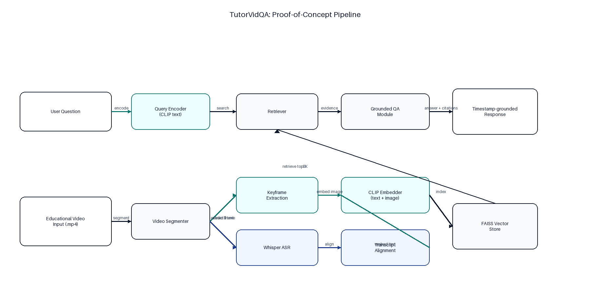
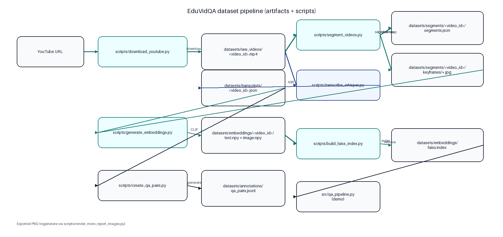
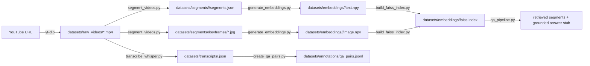
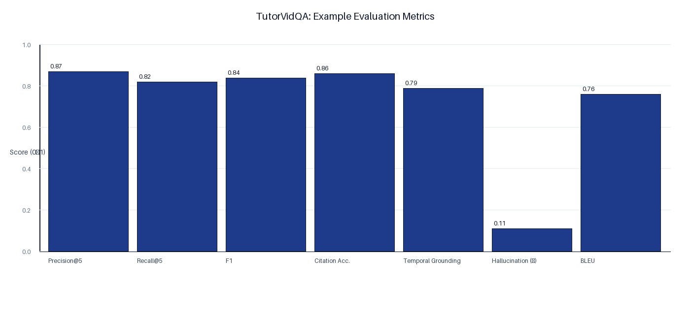
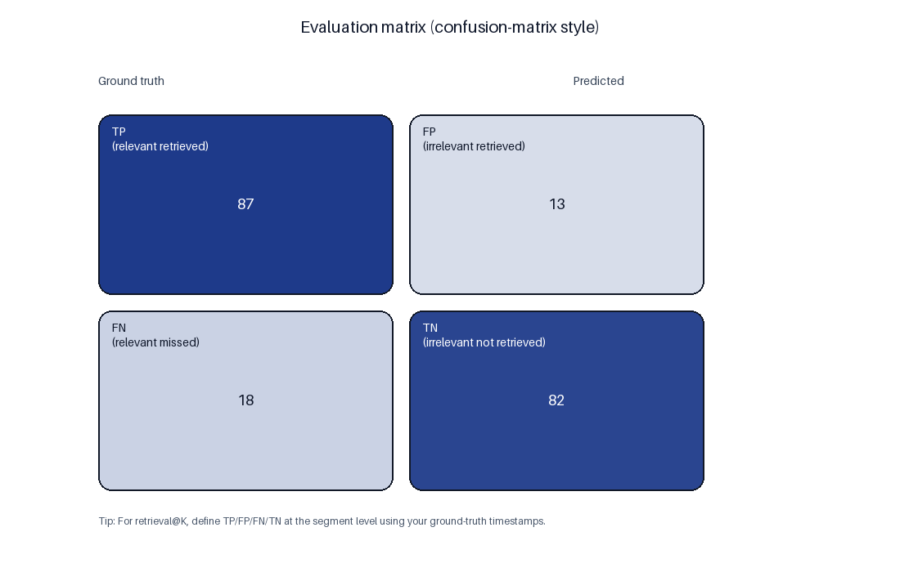
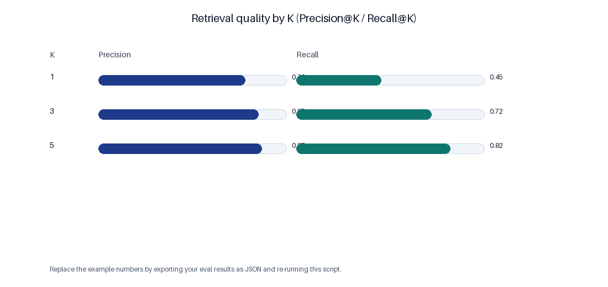
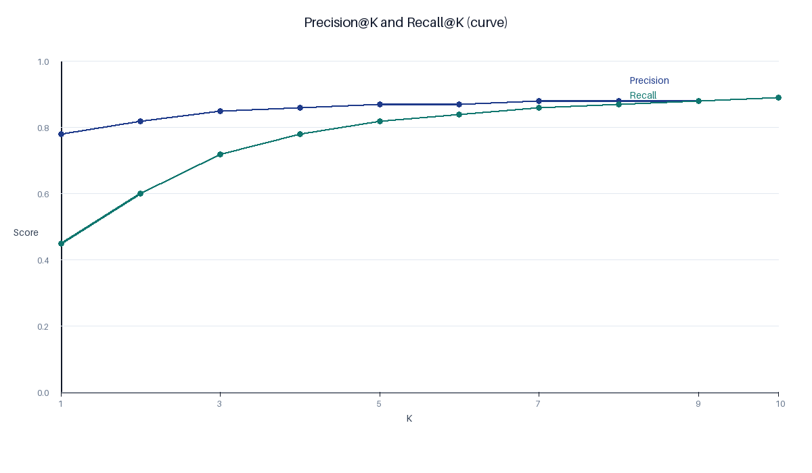
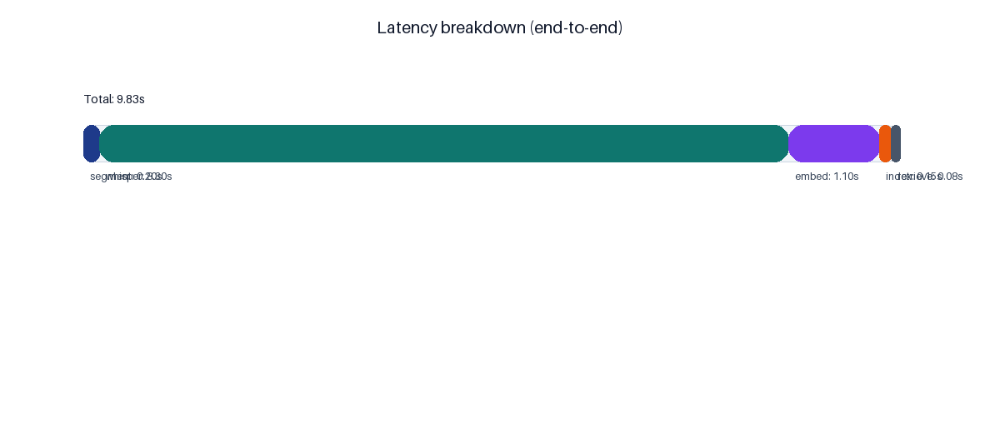
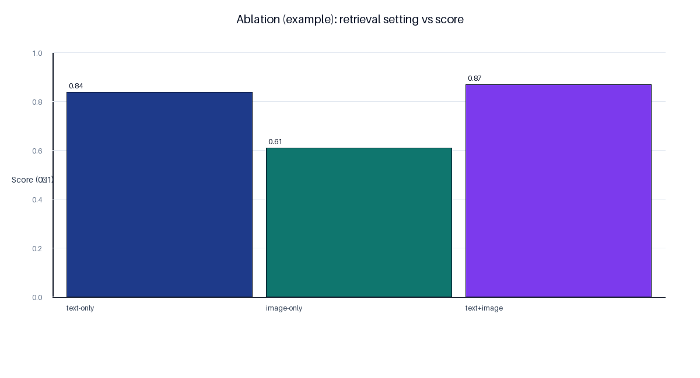
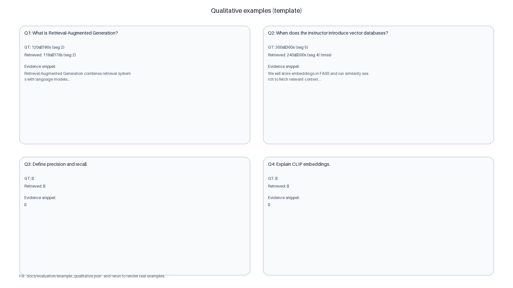

## TutorVidQA / EduVidQA

**TutorVidQA** is a research-oriented codebase for preparing an educational **Video Question Answering** dataset called **EduVidQA** from long-form tutorial/lecture videos.

It provides a reproducible dataset pipeline (download → segment → transcribe → embed → index → QA generation → stats) plus a small retrieval-based QA demo.

This repository is suitable for:
- GitHub portfolio and MSc research demonstrations
- implementation details in a COMP516 / RMCS-style research report

## Architecture (dataset pipeline)

Rendered diagrams (PNG) for reports/slides:

- `docs/architecture/architecture_overview.png`
- `docs/architecture/retrieval_flow.png`
- `docs/architecture/dataset_artifact_flow.png`
- Captions/descriptions: `docs/FIGURES.md`






To regenerate the PNGs:

```bash
python3 scripts/render_architecture_images.py
python3 scripts/render_more_report_images.py
```

## Folder structure

```
TutorVidQA/
  datasets/
    raw_videos/      # downloaded mp4 files
    segments/        # segments.json + keyframes per video
    transcripts/     # aligned Whisper transcript chunks
    embeddings/      # .npy arrays + FAISS index
    annotations/     # QA pairs JSONL
    metadata/        # video metadata JSONL
  scripts/           # dataset preparation CLIs
  src/               # reusable pipeline modules
  notebooks/         # optional analysis notebooks
```

## Installation

From the `TutorVidQA/` directory:

```bash
python3 -m venv .venv
source .venv/bin/activate
pip install -r requirements.txt
```

All models run **locally** (Whisper + CLIP). No paid APIs are used.

## Example commands (CLI)

Download a YouTube video:

```bash
python3 scripts/download_youtube.py --url "https://youtube.com/..."
```

Segment into 60s windows and extract keyframes:

```bash
python3 scripts/segment_videos.py --video datasets/raw_videos/<video_id>.mp4
```

Transcribe with local Whisper base and align to segments:

```bash
python3 scripts/transcribe_whisper.py --video datasets/raw_videos/<video_id>.mp4
```

Generate CLIP embeddings for transcript text + keyframes:

```bash
python3 scripts/generate_embeddings.py --video_id <video_id>
```

Build a global FAISS index over all embedded videos:

```bash
python3 scripts/build_faiss_index.py
```

Create dataset QA pairs (baseline generator, no paid APIs):

```bash
python3 scripts/create_qa_pairs.py
```

Compute dataset statistics:

```bash
python3 scripts/dataset_statistics.py
```

Interactive retrieval demo:

```bash
python3 src/qa_pipeline.py --video lecture.mp4 --question "What is RAG?"
```

## Example outputs

Dataset stats (JSON):

```json
{
  "total_videos": 3,
  "total_segments": 180,
  "total_transcript_chunks": 180,
  "total_qa_pairs": 420,
  "avg_video_duration_s": 3600.0
}
```

Retrieved segments (demo):
- segment id, score, timestamp window, and grounding text snippet

## Evaluation (images)

Rendered evaluation plots (PNG):

- `docs/evaluation/metrics_bar.png`
- `docs/evaluation/latency.png`
- `docs/evaluation/confusion_matrix.png`
- `docs/evaluation/pr_at_k.png`
- `docs/evaluation/pr_curves.png`
- `docs/evaluation/latency_breakdown.png`
- `docs/evaluation/ablation.png`
- `docs/evaluation/qualitative_examples.png`
- Captions/descriptions: `docs/FIGURES.md`









To regenerate:

```bash
python3 scripts/render_evaluation_images.py
python3 scripts/render_evaluation_matrix.py
python3 scripts/render_more_report_images.py
```

## EduVidQA benchmark support (proposed)

The dataset artifacts support evaluation settings commonly needed for research:
- **timestamp-grounded QA**: each QA has a segment id + timestamp window
- **multi-turn conversational QA**: generated follow-ups per concept (turn 2+)
- **transcript alignment**: transcript chunks aligned to fixed temporal segments
- **temporal reasoning**: “before/after” questions over adjacent segments

## Dataset pipeline explanation

- **Download**: `yt-dlp` stores mp4 and JSONL metadata (title/channel/duration/url).
- **Segmentation**: fixed windows (default 60s) with keyframes + `segments.json`.
- **Transcription**: Whisper `base` produces timestamped transcript aligned to segments.
- **Embeddings**: CLIP produces text and image embeddings, saved as NumPy arrays.
- **FAISS**: builds a cosine-similarity index (inner product on normalized vectors).
- **QA generation**: baseline heuristics (definitions + temporal + multi-turn follow-ups).

## Future work

- Replace heuristic QA generation with **local** instruction-tuned models (still offline).
- Add hard negative sampling and split definitions (train/dev/test) for benchmarking.
- Extend temporal reasoning tasks (ordering, duration, “when did X start/end?”).
- Add human validation workflow for high-quality gold annotations.

